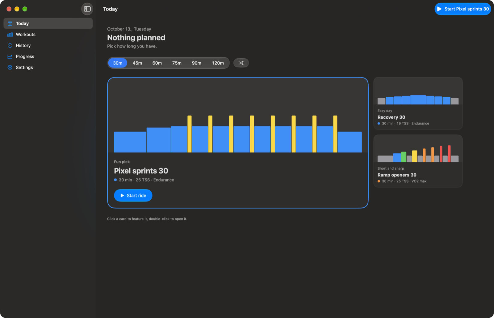
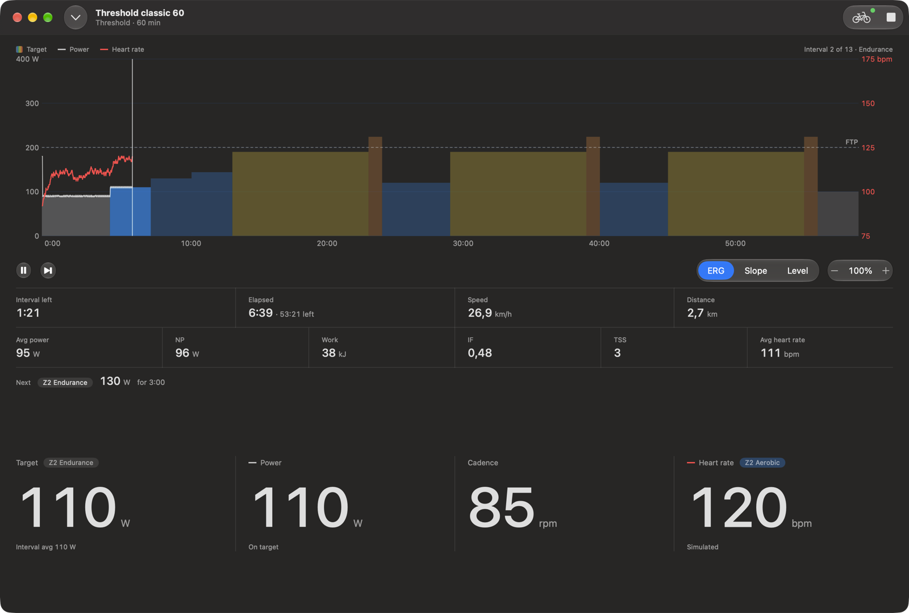
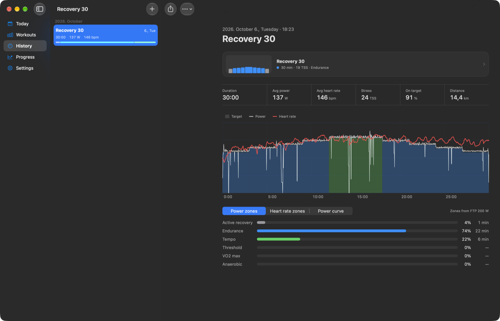
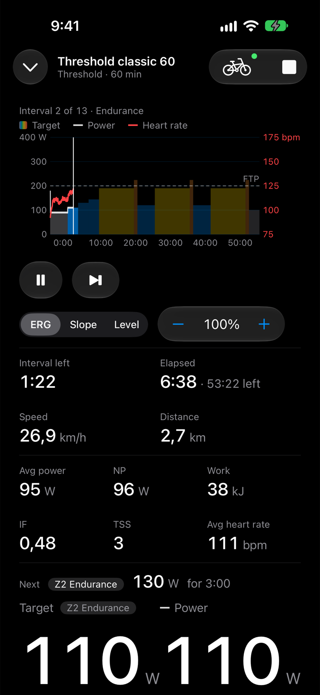
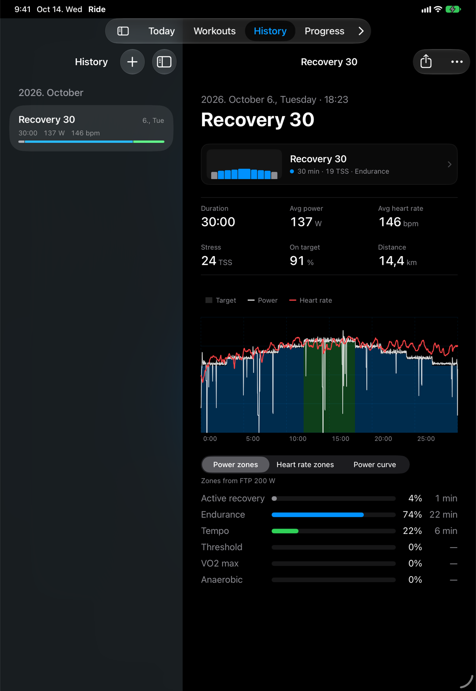

# TrainStack

TrainStack is an open source training app for serious amateur athletes. Today it is
**TrainStack Ride**, an indoor cycling app for iPhone, iPad, Mac and Apple Watch: pick a
structured workout, Ride sets your smart trainer's resistance for every interval, and it saves
the ride as a standard `.fit` file you can send to Strava.

|                                            Today                                             |                                      Player                                      |                                            History                                            |
| :------------------------------------------------------------------------------------------: | :------------------------------------------------------------------------------: | :-------------------------------------------------------------------------------------------: |
|  |  |  |
|                             Workouts that fit the time you have                              |                         Structured workouts in ERG mode                          |                           Power, heart rate and zones for each ride                           |

|                                         iPhone                                         |                                       iPad                                       |
| :------------------------------------------------------------------------------------: | :------------------------------------------------------------------------------: |
|  |  |

## Where it is going

Training is split across many apps today: one records, one plans, one tracks recovery, one
runs indoor sessions, and none of them sees the whole athlete. The long-term goal is the whole
training stack in one app: tracking across sports, plans generated from your goals and kept up
to date as life happens, recovery from sleep and wearable data, training scheduled around your
calendar, sharing with friends, and tools for coaches and clubs. Ride comes first because it is
useful on its own, and every ride produces the structured data the rest builds on. See
[the thesis](docs/THESIS.md) for more.

## Current state

Ride is an early alpha. See [the alpha guide](docs/ride-alpha.md) for what works, what does
not yet, and what to test first.

- Ride works without an account. Rides and settings stay on your device.
- You can create a TrainStack account with Sign in with Apple, and link it to Strava to send
  rides there.
- The Strava connection is limited to 10 users for now, so linking may not be available to you
  yet.

## Use at your own risk

TrainStack is experimental software, and everything you do with it is at your own risk. There
is no privacy policy or terms of service yet. They are coming, but until they exist, do not
rely on TrainStack for anything you cannot afford to lose, and export rides you want to keep.

## Contributing

If you want to help, please [open an issue](https://github.com/richard-better/trainstack/issues/new)
and say what you would like to work on, or report a Ride bug with the
[Ride bug report](https://github.com/richard-better/trainstack/issues/new?template=ride-bug.yml).
See [CONTRIBUTING.md](CONTRIBUTING.md) before sending a pull request.

## Development

Ride lives in [`apps/ride`](apps/ride): see [`apps/ride/AGENTS.md`](apps/ride/AGENTS.md) to
build it and [the release guide](docs/ride-release.md) to ship a TestFlight build. The hosted
website, API and account app are deployed as described in [the deployment guide](docs/deployment.md).

## License

TrainStack is open source under AGPL-3.0. The hosted backend in `hosted/` is source-available under FSL-1.1-ALv2, and packages that other code builds on, like the API contract, are explicitly Apache-2.0. See [LICENSING.md](LICENSING.md).
